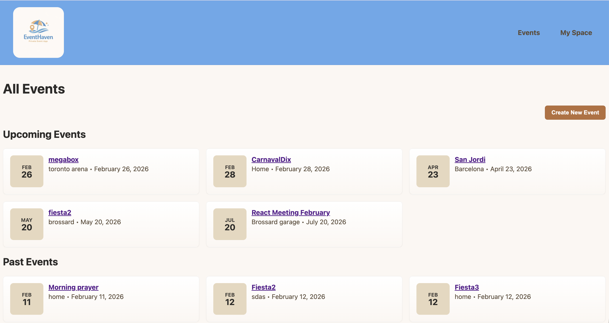
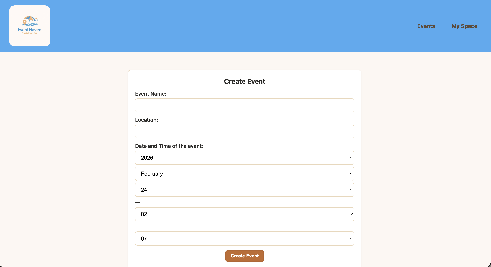
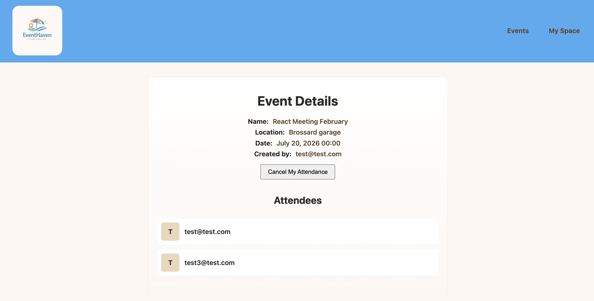
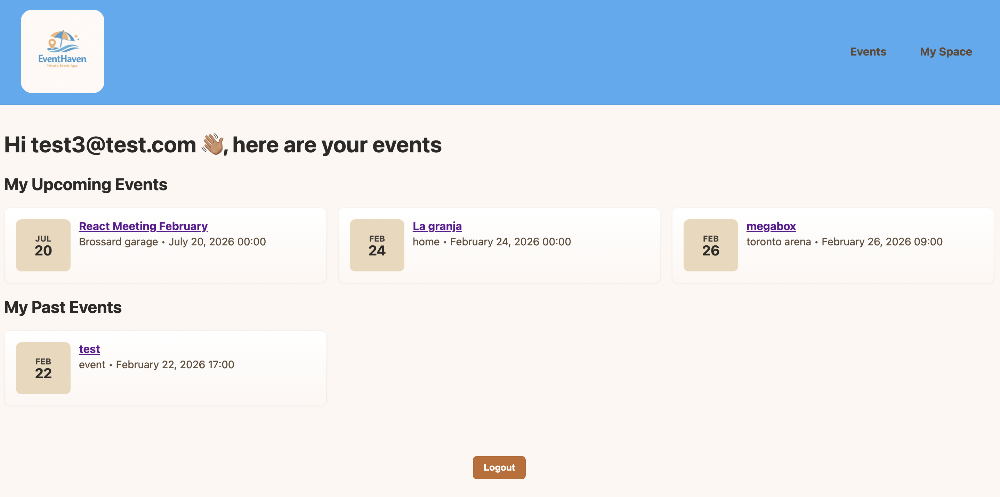
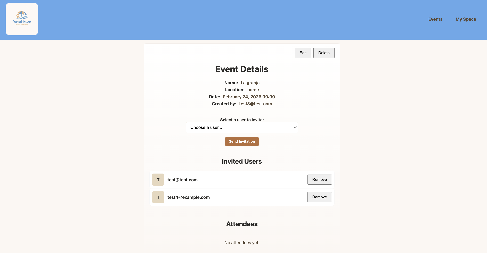

# EventHaven

## Description

EventHaven is a Rails application built as part of The Odin Project. The app allows users to create and attend private events in an Eventbrite style.

## 🌟 Demo

The app is deployed on Render and can be accessed at the following URL: https://private-events-s1ol.onrender.com

Want to see the app in action? Check out this demo video:
https://www.loom.com/share/0138ba1efe364ab9b363e628b960f4b6

## Getting Started

- Clone the repository

```bash
git clone https://github.com/keshiacor/private-events.git
```

- Navigate into the project directory

```bash
cd private-events
```

- Install Ruby gems

```bash
bundle install
```

- Run the database migrations to set up the database schema

```bash
bin/rails db:migrate
```

- Start the Rails server

```bash
bin/rails server
```

- Open the app in your browser

Visit `http://localhost:3000` and sign up for an account to start creating events.

## Technologies

- Ruby on Rails 8.1 – Web framework used to build the application.
- SQLite3 – Default development and test database.

## Features

- Users can sign up, log in, and log out using Devise for authentication.
- Users can create events with a name, description, date, and location.
- Users can only access/click on events they have created or events they've been invited to.
- All users can see the list of all events but they can only access events they have created or events they've been invited to as an attendee.
- Users are automatically marked as attending the events they create.
- Users can only invite other existing users to events they have created.
- Users can rescind an invitation they have sent to another user.
- Users can edit, update or delete an event they have created.
- An event can have multiple attendees.
- The event page should separate events into upcoming vs past events. Upcoming events should be listed first, followed by past events.
- Users are automatically marked as attending events they have created.
- Attendees can see all attendees of an event they are attending.

Out of scope for this project:

- Sending notification emails for event invitations via email.
- Handling timezones for event dates and times.

## Usage

Events Page


Event creation form


Event details page - invitee's view


User's my space showing upcoming and past events


Event details page - creator's view


## Important Dependencies

- Devise – Used for user authentication and management.
- RSpec – Used for testing the application.
